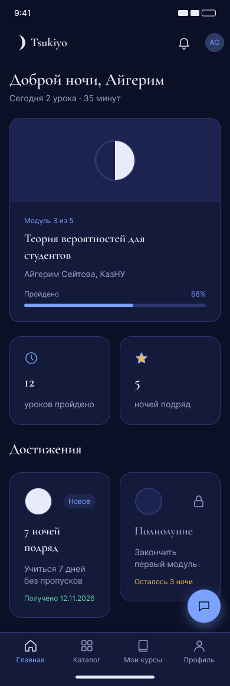
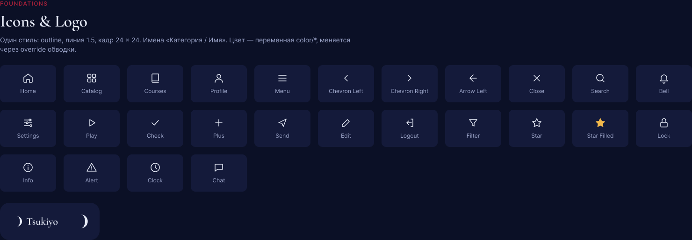
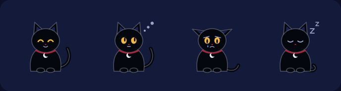
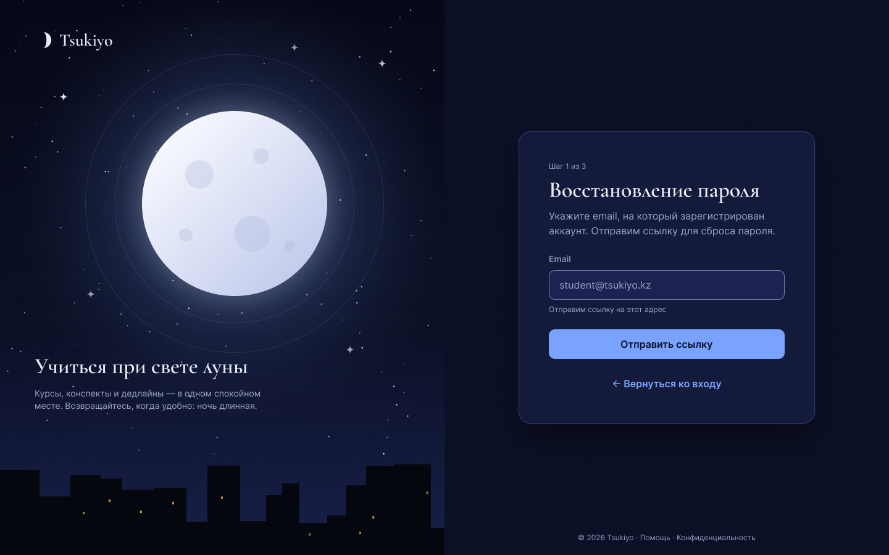
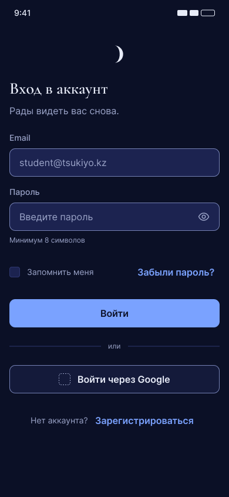

# Tsukiyo — скилл дизайн-системы для Claude

Скилл учит Claude собирать макеты в Figma на дизайн-системе **Tsukiyo** — учебной платформы в стиле «лунная ночь» (月夜). Десктоп 1440 и мобилка 390, тёмная тема, русский и казахский интерфейс.

Автор: Karsakbayev Medet · файл Figma: «Karsakbayev Medet — Tsukiyo» · текущая версия: **1.4.0**

## Установка

В Claude Code:

    /plugin marketplace add medetushka/tsukiyo-plugins
    /plugin install tsukiyo@tsukiyo-plugins

После установки перезапустите Claude Code. Для работы с файлом нужен подключённый Figma (плагин Figma для Claude). Скилл срабатывает сам, когда речь идёт о сборке экрана Tsukiyo, выборе компонента, иконки или токена.

Обновление до новой версии:

    /plugin marketplace update tsukiyo-plugins
    /plugin update tsukiyo@tsukiyo-plugins

## Что внутри дизайн-системы

| Слой | Состав |
|---|---|
| Цвета | Primitives (moon 9 оттенков, night, red, green, amber, sky, crimson) → семантика по ролям `color/*` + альфа-токены; контраст по WCAG 2.2 AA |
| Платформы | коллекция Platform: моды Desktop / Mobile меняют размеры заголовков и поля страницы |
| Текст | 9 стилей: Display, H1–H3 (Cormorant Garamond), Body, Small, Caption, Label, Button (Inter) |
| Отступы и радиусы | шкала 4–80, радиусы 6 / 10 / 20 / full, сетки 12 колонок (десктоп) и 4 (мобилка) |
| Компоненты | 41: формы, навигация, карточки, обратная связь, мобильные Status bar / App bar / Tab bar / Bottom sheet |
| Иконки и логотип | 26 иконок outline 1.5 × 24, Logo Full / Mark |
| Маскот | Ёру — чёрная кошка, 4 настроения |

## Как устроен скилл

    plugins/tsukiyo/skills/tsukiyo-design-system/
    ├── SKILL.md                 # правила, каталог «что когда брать», размеры, как дообучать
    └── references/
        ├── keys.md              # компоненты: node id, ключи, свойства
        ├── icons.md             # иконки: имена, id, ключи
        ├── tokens.md            # переменные, моды Desktop/Mobile, стили
        ├── patterns.md          # шаблоны экранов десктоп и мобилка, состояния, прототип
        ├── research.md          # ресерч других дизайн-систем и источники
        ├── test-prompts.md      # тестовые задачи и чек-лист проверки
        └── changelog.md         # история версий

`SKILL.md` — короткие правила и выбор, длинные списки и ключи лежат в `references`, Claude открывает их только когда нужно.

## Примеры работы

Экраны ниже Claude собрал по скиллу, только из компонентов системы — без сырых цветов и детачей.

| Десктоп: восстановление пароля | Мобилка: вход |
|---|---|
|  |  |

## Как скилл обучается

Цикл: задача → ошибка → правило → новая версия. Второй источник правил — ресерч других дизайн-систем (`references/research.md`). Задачи — в `references/test-prompts.md`, история — в `references/changelog.md`.

| Версия | Какая ошибка или задача | Что добавили |
|---|---|---|
| 1.0.0 | — | правила, каталог 24 компонентов, токены, шаблоны |
| 1.0.1 | Claude создал второй экран с тем же именем | правило 11: проверять дубли и переносить связи прототипа |
| 1.0.2 | тексты в компонентах без стилей | стили Label и Button |
| 1.1.0 | нужна мобилка и больше элементов | моды Desktop/Mobile, 17 компонентов, иконки, логотип, правила 12–15 |
| 1.1.1 | мобильный экран без сетки, имена мобилки путались | Grid/Mobile 4 col, нейминг `· Mobile`, маскот Ёру |
| 1.2.0 | — | раздел «Как дообучать скилл», тестовые задачи и чек-лист самопроверки |
| 1.2.1 | красные линии перекрывали луну на иллюстрации | луна чистая; правило «ничего не рисовать поверх луны» |
| 1.3.0 | ресерч Material 3, Apple HIG, Carbon, Polaris, Atlassian, Wonder Blocks | правила 16–21: Tab bar 3–5, зазор 8 между тач-зонами, Toast по одному, тексты ошибок, Bottom sheet или Modal, Empty state |
| 1.3.1 | прогон тестов 4–12: мелкие тач-зоны в Bottom sheet и Modal, нет видеоплеера, реальное имя в примерах | Button Text 44, крестик из пака, Video player, правило о вымышленных данных |
| 1.4.0 | прогон задач 13–20: нет списка выбора в Bottom sheet, нет ошибки у Checkbox/Radio, два «Назад» в онбординге, красный для неверного ответа | Bottom sheet Select, State=Error, шаблон Mobile onboarding, правила 22–24 |
